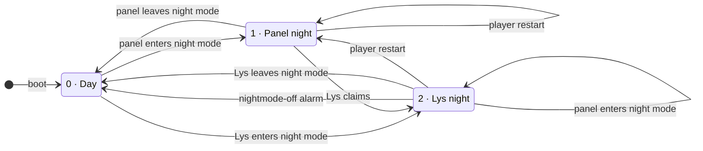

# `/tmp/nightmode` — whose night it is

The spec for the one record of the night, and the automaton over it
(chumby-pi issue 32). The state **is** the file; there is no second copy
anywhere, and no component keeps a private notion of "it is night".

Who acts on it:

| | |
|---|---|
| **the panel** | `controlpanel.swf`, the only writer of `1` |
| **the remote** | `chumby-rust-remote`, the only writer of `2` |
| **the supervisor** | the player's parent process, which notices a restart |
| **Lys** | the light widget — it never touches the file, it acts through the remote's commands |

## The automaton

Any event not drawn here leaves the state alone — a nightmode-off alarm in
Day, a touch in Lys night, a widget change in any state.

## The transitions

| From | Trigger | What happens | To |
|---|---|---|---|
| — | boot | the tmpfs is empty, so there is no record | 0 |
| 0 | **the panel enters night mode**: a nightmode-on alarm (F2:11094-11108), the Night button (`DefineSprite_1766/frame_2:43-56`), or the remote's `night` command through the NightMode soft event (F6:107-110) | the panel writes `1` (F2:19751) | 1 |
| 0 | **Lys enters night mode**: `screen dim` or `screen off` while claiming (`08-night.as:76-82`) | the remote writes `2` | 2 |
| 1 | **Lys claims** — loaded by a widget change, the channel's rotation or a jump, it claims as it does in every mode (`08-night.as:53-62`) | the remote sends `NightMode off`, the panel writes `0` (F2:19757), Lys is handed the night, and its `screen dim` writes `2` — within 5 s | 2 |
| 1 | **the panel leaves night mode**: a touch, key or bend on the night screen (F2:19606-19628, 19659, 19729), a nightmode-off alarm, or a `NightMode off` event | the panel writes `0` | 0 |
| 1 | **a player restart** | the panel reads `1` at startup (F2:359) and puts its night screen back up; nobody writes | 1 |
| 2 | **the panel enters night mode**: the 23:00 alarm or the Night button, with Lys still loaded | the panel writes `1`, the remote hands the night over on its next poll, the panel writes `0`, and Lys's next claim turns its night on again, whose `screen dim` writes `2` — about 7 s in all, of which the panel night screen is visible for the first 2 | 2, unchanged |
| 2 | **a nightmode-off alarm** — the remote's own scan of `/psp/alarms`, which does not need Lys to be loaded | the remote writes `0` and hands Lys a one-shot `handoff=day`; **Lys stays the displayed widget** and goes back to its clock | 0 |
| 2 | **Lys leaves night mode**: its Tag button, `screen bright` (`08-night.as:89-94`) | the remote writes `0` | 0 |
| 2 | **a player restart** | the record survives the restart, but Lys does not: the panel comes up on the first widget of the channel, so when the supervisor's `panel-start` makes the remote send `NightMode on`, nothing claims and the night stays the panel's | 1 |

## What does not move the state

- **Unloading Lys.** Whoever does it — the player on a restart, the user
  navigating away (the bend button into the control panel, or the widget
  dropdown), the channel's rotation timer, or a jump from the remote — the
  record is untouched. When Lys comes back, its first claim is answered
  `handoff=night` and its night screen returns within 5 s (I5). The one
  place this shows up as a transition is the player restart out of state 2,
  which has a row of its own, because there the panel restarts into day and
  the remote then puts a night back up.
- **The screen going bright or dark.** The backlight is Lys's 15 s `screen`
  lease, not the record (I4).
- **A touch, a bend, or a widget change in state 2.** The panel is in widget
  mode there; none of it reaches the record.

## Invariants

- **I1.** Only the panel ever writes `1`. The remote writes `2` only over a
  `0`, and `0` only over a `2`, so a panel night is never clobbered and a
  `1` never becomes a `2` behind the panel's back.
- **I2.** A boot means day: the file is on the tmpfs (R6/D8).
- **I3.** `2` is invisible to the panel. Both of its reads are `== "1"`
  string compares (F2:359, `DefineSprite_1766/frame_1:149`) with no `int()`
  anywhere — unlike `/psp/dimlevel`, which *is* `int()`-parsed (F2:9060).
  A `1` could not carry state 2: `exitNightMode` ends at
  `gotoAndStop("idle")` (F2:19622), the idle frame re-reads the file, and a
  `1` would pull the panel back into its night screen, which the remote
  would hand over again — a flip-flop at `POLL` = 2 s.
- **I4.** The record says *whose* night it is, not how dark the screen is.
  In state 2 the backlight stays Lys's 15 s `screen` lease, so the control
  panel is usable at night and a crashed widget leaves no dark box.
- **I5.** While the record is `2`, every `claim` reply carries
  `handoff=night`. This is what makes state 2 survive an unload: a reloaded
  Lys starts with `night = false` (`08-night.as:10`) and is put back into
  its night mode by the next renewal, at most 5 s later. Its handler is
  idempotent (`08-night.as:56-61`), so repeating it costs nothing; only a
  change is logged.
- **I6.** A day handoff wins over I5 in the same reply: the alarm's one-shot
  comes with the remote's own clear of the record, so the two cannot
  disagree.

## Consequences worth knowing before judging the spec

1. **A restart in Lys night comes back as Panel night.** The dark is kept,
   but it is the panel night screen with its own clock, not Lys. It is the
   only edge in the machine that moves a night from Lys to the panel, and it
   follows from restoring with `NightMode on` and no jump (Jan,
   2026-11-05). The fix, if it ever matters, is the jump that was ruled out.
2. **Leaving Lys at night brightens the screen** (I4) while the record goes
   on saying `2`. Coming back to Lys turns its night on again (I5).
3. **The panel night screen flashes for about 2 s** whenever the panel
   enters night mode with Lys loaded — the 23:00 alarm, the Night button,
   the `night` command. That is today's behaviour, not a change.
4. **A stale `2`** can only come from the remote dying or being upgraded
   mid-night. The panel is unaffected (I3); the remote would put a night
   back up at the next `panel-start`, until the nightmode-off alarm clears
   the record.
