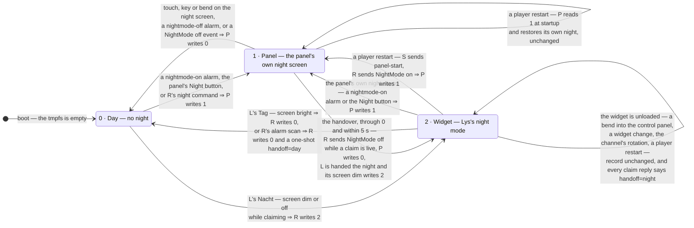

# `/tmp/nightmode` — whose night it is

The spec for the one record of the night, and the automaton over it
(chumby-pi issue 32). The state **is** the file; there is no second copy
anywhere, and no component keeps a private notion of "it is night".

Actors:

| | |
|---|---|
| **P** | the panel, `controlpanel.swf` |
| **R** | `chumby-rust-remote` |
| **S** | the supervisor, `chumby-player`'s parent process |
| **L** | the Lys widget — it never touches the file, it acts through R's commands |

## The automaton

## The transitions, with their writer

| From | Trigger | Writer | To |
|---|---|---|---|
| — | boot | nobody — the file is on the tmpfs | 0 |
| 0 | alarm `action=nightmode` `on` (F2:11094-11108), the panel's Night button (`DefineSprite_1766/frame_2:43-56`), or R's `night` command through the NightMode soft event (F6:107-110) | P writes `1` (F2:19751) | 1 |
| 0 | L enters its night: `screen dim` / `screen off` while claiming (`08-night.as:76-82`) | R writes `2` | 2 |
| 1 | R sees a live claim or stay-awake and sends `NightMode off` (the handover) | P writes `0` (F2:19757) | 0, then 2 once L's `screen dim` arrives (≤ 5 s) |
| 1 | touch, key or bend on the night screen (F2:19606-19628, 19659, 19729) | P writes `0` | 0 |
| 1 | alarm `action=nightmode` `off`, or a `NightMode off` event | P writes `0` | 0 |
| 1 | a player restart | P reads `1` (F2:359) and writes nothing | 1 |
| 2 | L's Tag: `screen bright` (`08-night.as:89-94`) | R writes `0` | 0 |
| 2 | R's alarm scan: an enabled nightmode-off alarm due this minute | R writes `0`, plus a one-shot `handoff=day` | 0 |
| 2 | the panel enters its own night (the 23:00 alarm, the Night button) | P writes `1` | 1 — and the handover returns to 2 if a claim is live |
| 2 | the widget is unloaded — a bend into the control panel, a widget change, the channel's rotation, a player restart | nobody | **2, unchanged** |
| 2 | a player restart | S sends `panel-start`, R sends `NightMode on`, P writes `1` | 1 — back to 2 by the handover if L is still the widget behind it |

## Invariants

- **I1.** Only P ever writes `1`. R writes `2` only over a `0`, and `0` only
  over a `2`, so a panel night is never clobbered and a `1` never becomes a
  `2` behind the panel's back.
- **I2.** A boot means day: the file is on the tmpfs (R6/D8).
- **I3.** `2` is invisible to P. Both panel reads are `== "1"` string
  compares (F2:359, `DefineSprite_1766/frame_1:149`) with no `int()`
  anywhere — unlike `/psp/dimlevel`, which *is* `int()`-parsed (F2:9060).
  A `1` could not carry state 2: `exitNightMode` ends at
  `gotoAndStop("idle")` (F2:19622), the idle frame re-reads the file, and a
  `1` would pull the panel back into its night screen, which R would hand
  over again — a flip-flop at `POLL` = 2 s.
- **I4.** The record says *whose* night it is, not how dark the screen is.
  In state 2 the backlight stays the widget's 15 s `screen` lease, so the
  control panel is usable at night and a crashed widget leaves no dark box.
- **I5.** While the record is `2`, every `claim` reply carries
  `handoff=night`. This is what makes state 2 survive an unload: a reloaded
  Lys starts with `night = false` (`08-night.as:10`) and is put back into
  its night mode by the next renewal, at most 5 s later. The handler is
  idempotent (`08-night.as:56-61`), so repeating it costs nothing; only a
  change is logged.
- **I6.** A day handoff wins over I5 in the same reply: the alarm's one-shot
  comes with R's own clear of the record, so the two cannot disagree.

## Consequences worth knowing before judging the spec

1. **A restart in state 2 lands on the panel's night screen, not Lys's.**
   The fresh panel loads the channel's *first* widget — Chumby Analog Clock
   on chumby-pi-3 — so there is no Lys behind the night screen to claim and
   it stays in state 1 until the nightmode-off alarm. The screen is dark,
   but it is the panel's dark clock. This follows from restoring with
   `NightMode on` and no jump (Jan, 2026-11-05).
2. **Leaving Lys at night brightens the screen** (I4) while the record goes
   on saying `2`. Returning to Lys puts its night screen back (I5).
3. **The 23:00 alarm while Lys is on screen** shows the panel's night screen
   for up to one poll (2 s) before the handover gives the night back to Lys.
   That is today's behaviour, not a change.
4. **A stale `2`** can only come from R dying or being upgraded mid-night.
   The panel is unaffected (I3); R would restore a night that is over at the
   next `panel-start`, until the nightmode-off alarm clears it.
