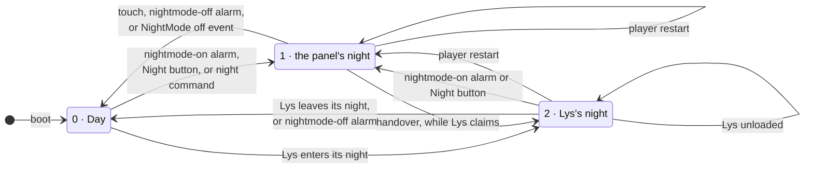

# `/tmp/nightmode` — whose night it is

The spec for the one record of the night, and the automaton over it
(chumby-pi issue 32). The state **is** the file; there is no second copy
anywhere, and no component keeps a private notion of "it is night".

Who acts on it:

| | |
|---|---|
| **the panel** | `controlpanel.swf`, the only writer of `1` |
| **the remote** | `chumby-rust-remote`, the only writer of `2` |
| **the supervisor** | the player's parent process, which notices a restart |
| **Lys** | the light widget — it never touches the file, it acts through the remote's commands |

## The automaton

## The transitions

| From | Trigger | What happens | To |
|---|---|---|---|
| — | boot | the tmpfs is empty | 0 |
| 0 | a nightmode-on alarm (F2:11094-11108), the panel's Night button (`DefineSprite_1766/frame_2:43-56`), or the remote's `night` command through the NightMode soft event (F6:107-110) | the panel writes `1` (F2:19751) | 1 |
| 0 | Lys enters its night: `screen dim` or `screen off` while claiming (`08-night.as:76-82`) | the remote writes `2` | 2 |
| 1 | the remote sees a live claim or stay-awake and sends `NightMode off` — the handover | the panel writes `0` (F2:19757); Lys is handed the night and its `screen dim` writes `2` within 5 s | 0, then 2 |
| 1 | touch, key or bend on the night screen (F2:19606-19628, 19659, 19729) | the panel writes `0` | 0 |
| 1 | a nightmode-off alarm, or a `NightMode off` event | the panel writes `0` | 0 |
| 1 | a player restart | the panel reads `1` at startup (F2:359) and restores its own night; nobody writes | 1 |
| 2 | Lys leaves its night: `screen bright` (`08-night.as:89-94`) | the remote writes `0` | 0 |
| 2 | the remote's alarm scan sees an enabled nightmode-off alarm due this minute | the remote writes `0` and hands Lys a one-shot `handoff=day` | 0 |
| 2 | the panel's own night starts — the 23:00 alarm, or the Night button | the panel writes `1`; the handover returns to 2 if a claim is live | 1 |
| 2 | Lys is unloaded — a bend into the control panel, a widget change, the channel's rotation, a player restart | nobody writes | **2, unchanged** |
| 2 | a player restart | the supervisor sends `panel-start`, the remote sends `NightMode on`, the panel writes `1`; back to 2 by the handover if Lys is still the widget behind it | 1 |

## Invariants

- **I1.** Only the panel ever writes `1`. The remote writes `2` only over a
  `0`, and `0` only over a `2`, so a panel night is never clobbered and a
  `1` never becomes a `2` behind the panel's back.
- **I2.** A boot means day: the file is on the tmpfs (R6/D8).
- **I3.** `2` is invisible to the panel. Both of its reads are `== "1"`
  string compares (F2:359, `DefineSprite_1766/frame_1:149`) with no `int()`
  anywhere — unlike `/psp/dimlevel`, which *is* `int()`-parsed (F2:9060).
  A `1` could not carry state 2: `exitNightMode` ends at
  `gotoAndStop("idle")` (F2:19622), the idle frame re-reads the file, and a
  `1` would pull the panel back into its night screen, which the remote
  would hand over again — a flip-flop at `POLL` = 2 s.
- **I4.** The record says *whose* night it is, not how dark the screen is.
  In state 2 the backlight stays Lys's 15 s `screen` lease, so the control
  panel is usable at night and a crashed widget leaves no dark box.
- **I5.** While the record is `2`, every `claim` reply carries
  `handoff=night`. This is what makes state 2 survive an unload: a reloaded
  Lys starts with `night = false` (`08-night.as:10`) and is put back into
  its night mode by the next renewal, at most 5 s later. Its handler is
  idempotent (`08-night.as:56-61`), so repeating it costs nothing; only a
  change is logged.
- **I6.** A day handoff wins over I5 in the same reply: the alarm's one-shot
  comes with the remote's own clear of the record, so the two cannot
  disagree.

## Consequences worth knowing before judging the spec

1. **A restart in state 2 lands on the panel's night screen, not Lys's.**
   The fresh panel loads the channel's *first* widget — Chumby Analog Clock
   on chumby-pi-3 — so there is no Lys behind the night screen to claim, and
   it stays in state 1 until the nightmode-off alarm. The screen is dark,
   but it is the panel's dark clock. This follows from restoring with
   `NightMode on` and no jump (Jan, 2026-11-05).
2. **Leaving Lys at night brightens the screen** (I4) while the record goes
   on saying `2`. Returning to Lys puts its night screen back (I5).
3. **The 23:00 alarm while Lys is on screen** shows the panel's night screen
   for up to one poll (2 s) before the handover gives the night back to Lys.
   That is today's behaviour, not a change.
4. **A stale `2`** can only come from the remote dying or being upgraded
   mid-night. The panel is unaffected (I3); the remote would restore a night
   that is over at the next `panel-start`, until the nightmode-off alarm
   clears it.
